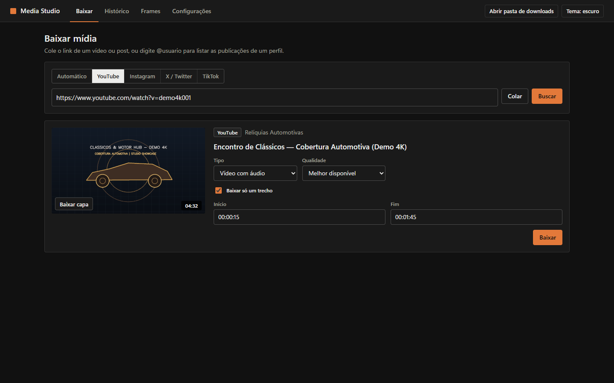
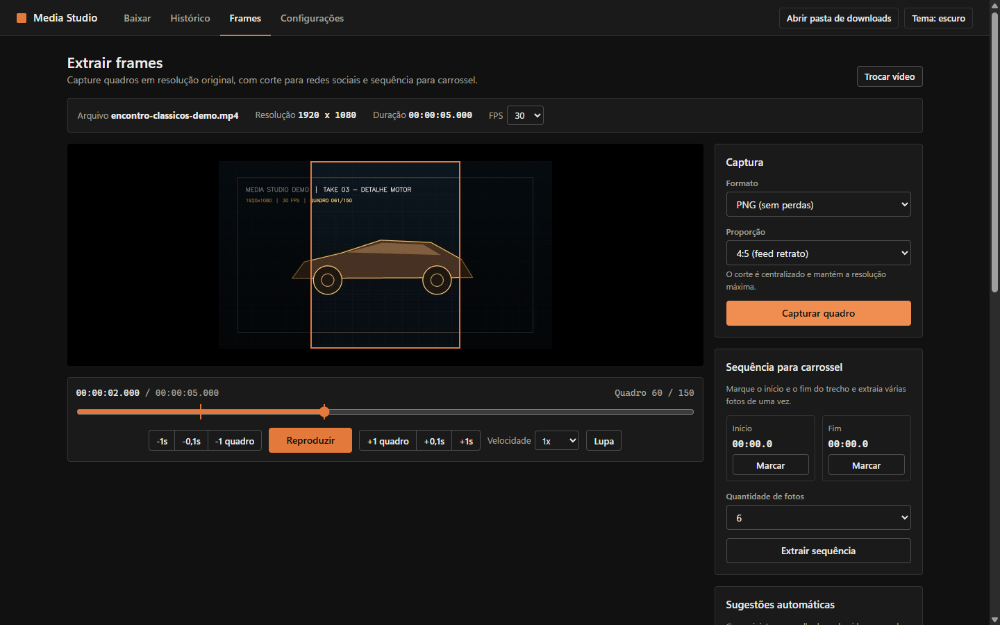
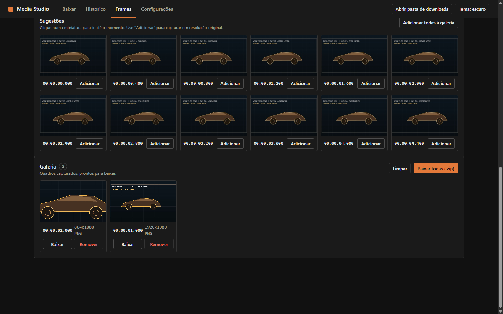
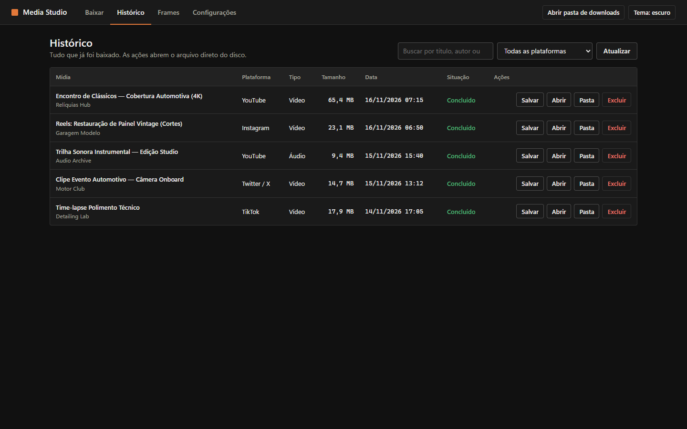

# Media Studio

Ferramenta local do Relíquias para preparar mídia para as redes. Junta em um só lugar os antigos **MediaDownloader Pro** e **FrameStudio (video-frame-extrator)**:

- **Baixar**: vídeos, áudios e fotos do YouTube, Instagram (posts, Reels e carrosséis), X, TikTok e outros sites suportados pelo yt-dlp. Também lista as publicações de um perfil para baixar várias de uma vez.
- **Frames**: abre um vídeo ou foto do computador (JPG, PNG, WebP e `.HEIC`/`.HEIF`), aplica correção automática de rotação EXIF e cores para sRGB, permite mover o ponto focal e o zoom em tempo real, corta para 16:9, 9:16, 1:1 e 4:5 (com opção de padronizar para 1080x1350 ou encaixar sem cortes sobre fundo desfocado), além de gerar sequência para carrossel, sugestões automáticas, lupa de foco, processamento em lote via CLI (`python -m app.frames.batch_cli`) e **desfoque de placas em vídeos com rastreamento de movimento (motion track)**, corte temporal e silenciamento ou preservação de áudio na exportação em MP4.
- **Histórico** dos downloads e **Configurações** (pasta de destino, qualidade padrão e tema claro/escuro).

Tudo roda neste computador. Os vídeos enviados para o extrator não saem da máquina.

## Capturas da Interface

> Capturas geradas em ambiente isolado de demonstração.

| Download de Mídia (YouTube / Instagram) | Extrator de Frames (Recorte 4:5 e Carrossel) |
| :---: | :---: |
|  |  |
| **Histórico de Downloads** | **Configurações Locais** |
|  |  |

## Como usar

1. Dê dois cliques em `iniciar-servidor-local.bat`.
2. Na primeira vez, escolha `[4]` para criar o ambiente e instalar as dependências.
3. Escolha `[1]`: o servidor sobe em segundo plano e o navegador abre em `http://localhost:8810`.
4. Para desligar, abra o mesmo arquivo e escolha `[2]`.

Pelo terminal:

```powershell
py -3.11 -m venv .venv
.venv\Scripts\python.exe -m pip install -r backend\requirements.txt
cd backend
..\.venv\Scripts\python.exe -m app
```

Requisitos: Windows 10/11 e Python 3.11. O FFmpeg é baixado automaticamente pelo pacote `static-ffmpeg` na primeira execução.

## Configuração (variáveis de ambiente, todas opcionais)

| Variável | Padrão | Para que serve |
|---|---|---|
| `MS_PORT` | `8810` | Porta do servidor |
| `MS_HOST` | `127.0.0.1` | Endereço de escuta. Qualquer valor fora da própria máquina exige `MS_ACCESS_TOKEN` |
| `MS_ACCESS_TOKEN` | (vazio) | Token de acesso pela rede (mínimo 24 caracteres). Abra `http://IP:PORTA/?token=...` uma vez para criar a sessão |
| `MS_MAX_UPLOAD_MB` | `4096` | Tamanho máximo de vídeo no extrator |
| `MS_MAX_DIRECT_MEDIA_MB` | `1024` | Tamanho máximo de fotos/vídeos baixados direto (Instagram) |
| `MS_FRAME_SESSION_TTL_MIN` | `30` | Minutos sem uso até liberar um vídeo do extrator |
| `MS_MAX_FRAME_SESSIONS` | `4` | Vídeos abertos ao mesmo tempo no extrator |
| `MS_MAX_CONCURRENT_DOWNLOADS` | `3` | Downloads simultâneos |
| `MS_MAX_TRACK_SAMPLES` | `1800` | Máximo de quadros analisados por rastreamento de placa |
| `MS_MAX_BACKWARD_BUFFER` | `600` | Máximo de quadros em memória ao rastrear para trás |
| `MS_MAX_BLUR_TRACKS` | `10` | Limite de máscaras de desfoque simultâneas por vídeo |
| `MS_MAX_EXPORT_DIMENSION` | `1920` | Teto do lado maior (px) ao exportar vídeo sem padronização |

## Segurança

- Por padrão o servidor só aceita conexões da própria máquina e recusa requisições endereçadas a outros nomes de site (proteção contra DNS rebinding).
- Toda ação que altera algo exige o cabeçalho `X-Media-Studio`, que outros sites não conseguem enviar. Não há CORS liberado.
- Links externos são conferidos antes de qualquer acesso: endereços da rede local ou internos são recusados.
- Só arquivos de mídia podem ser abertos, entregues ou apagados pelo histórico. Pastas do sistema não podem ser usadas como destino.
- A interface monta o conteúdo sem `innerHTML`; títulos e legendas vindos da internet nunca viram código. A página roda com Content-Security-Policy restrita e sem scripts de terceiros.

## Estrutura

```text
media-studio/
├── backend/
│   ├── app/
│   │   ├── main.py            # app FastAPI, inicialização e rotas
│   │   ├── config.py          # caminhos, limites e variáveis MS_*
│   │   ├── security.py        # acesso local, cabeçalho anti-CSRF, token de rede
│   │   ├── net_guard.py       # validação de links externos e downloads com limite
│   │   ├── database.py        # SQLite com migrations incrementais
│   │   ├── downloads/         # yt-dlp, Instagram, fila, histórico, configurações
│   │   └── frames/            # extrator: motor OpenCV/PyAV/Pillow, rastreamento e exportação MP4, sessões, uploads, CLI em lote e rotas
#   engine.py, image_engine.py, video_blur.py, uploads.py, registry.py, routes.py, image_routes.py, video_routes.py, batch_cli.py
│   ├── tests/                 # testes automatizados de backend (pytest)
│   ├── e2e/                   # testes E2E no navegador headless (Playwright)
│   ├── requirements.txt
│   └── requirements-e2e.txt
├── frontend/                  # HTML, CSS e módulos JS (sem build)
├── docs/                      # históricos dos projetos originais, ideias e capturas (screenshots/)
├── data/                      # banco local (fora do Git)
├── downloads/                 # pasta padrão dos downloads (fora do Git)
├── logs/                      # logs (fora do Git)
└── iniciar-servidor-local.bat
```

## Testes

```powershell
cd backend
..\.venv\Scripts\python.exe -m pytest
```

Testes de navegador ponta a ponta (E2E em Chromium invisível, sem abrir janela na tela):

```powershell
.venv\Scripts\python.exe -m pip install -r backend\requirements-e2e.txt
# Caso o navegador ainda não esteja no cache local do Playwright (%LOCALAPPDATA%\ms-playwright):
.venv\Scripts\playwright.exe install chromium
cd backend
..\.venv\Scripts\python.exe -m pytest e2e -v
```

Os testes (unitários e E2E) sobem tudo de forma isolada com banco, logs e pastas temporárias, nunca tocando nos dados reais. As skills globais de QA (`/qa-test` e `/qa-sheets-sync`) permanecem centralizadas no `antigravity-config`, sem duplicação dentro do projeto.

## Licença

MIT. Veja [LICENSE](LICENSE).

## Preparo em lote de fotos e quadros (CLI)

Com o ambiente virtual do backend ativo na pasta `backend/`:

```bash
python -m app.frames.batch_cli --manifest caminho/do/manifesto.json --dry-run
python -m app.frames.batch_cli --manifest caminho/do/manifesto.json
python -m app.frames.batch_cli --input-dir "./# Originais" --output-dir "./Saida" --aspect-ratio 4:5 --format png
```

Fotos muito largas (`wide_crop`, ex.: `16:9` que perde mais de 45% da largura em `4:5`) ficam pausadas por padrão (`status: "needs_decision"`, código de saída `2`, sem gravar arquivo) até decisão explícita (`"approved": true` ou `"fit_mode": "contain_blur"` no manifesto, ou flag `--allow-wide`). Com `--strict`, o mesmo bloqueio vale também para recortes em baixa resolução (`low_resolution`).

Variáveis adicionais de ambiente para fotos estáticas:
- `MS_MAX_IMAGE_MB` (padrão `100`): limite em MB por upload de imagem na rota `/api/frames/images`.
- `MS_MAX_IMAGE_PIXELS` (padrão `120000000`): teto de segurança contra imagens gigantes/descompressão abusiva.
- `MS_MAX_IMAGE_SESSIONS` (padrão `8`): máximo de fotos mantidas simultaneamente em sessão de memória.
